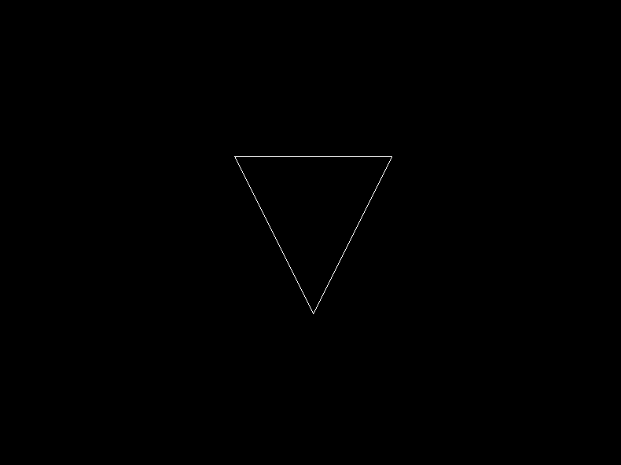
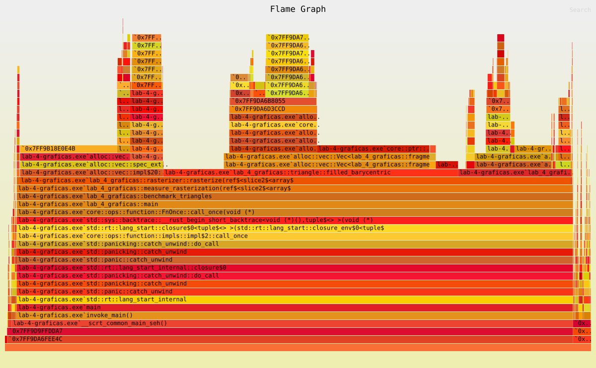

# Laboratorio 5: rasterización de triángulos

El programa implementa tres modos de rasterización:

- Contorno mediante tres líneas.
- Relleno con coordenadas baricéntricas.
- Relleno por líneas horizontales.

## Resultados visuales

### Contorno



### Relleno baricéntrico


### Relleno por filas


Los dos métodos de relleno producen la misma figura. Esto también se comprobó comparando las posiciones de los fragmentos para triángulos pequeños, grandes, con bordes horizontales y verticales, con los vértices en orden inverso, parcialmente fuera del framebuffer y degenerados.

## Reglas de los bordes

Ambos algoritmos evalúan el centro del píxel en `(x + 0.5, y + 0.5)`.

El método baricéntrico incluye el píxel cuando sus tres coordenadas baricéntricas son mayores o iguales que cero. El método por filas ignora las aristas horizontales al calcular intersecciones y genera un único tramo entre la intersección izquierda y la derecha. Los extremos se convierten a píxeles comprobando que sus centros estén dentro de ese tramo.

Los triángulos con área cero no generan fragmentos. Invertir el orden de sus vértices tampoco cambia las posiciones generadas.

## Rendimiento

La medición se realizó con:

```text
cargo run --release -- --benchmark-triangles
```

Cada muestra ejecutó el algoritmo 100 veces. Se tomaron nueve muestras y se comparó su mediana. La actualización de la textura, el dibujo de la ventana y la espera entre cuadros quedaron fuera de la medición.

| Algoritmo | Mediana para 100 ejecuciones | Fragmentos |
| --- | ---: | ---: |
| Baricéntrico | 19.8627 ms | 6219 |
| Por filas | 11.9021 ms | 6219 |

En esta ejecución, el algoritmo por filas fue aproximadamente un 40 % más rápido. Ambos produjeron la misma cantidad de fragmentos, por lo que la diferencia no se debe a que uno haya omitido parte de los triángulos.

## Perfil

El perfil se generó con:

```text
cargo flamegraph --release --output docs/flamegraph.svg -- --benchmark-triangles
```



`rasterize` aparece en el 94.14 % de las muestras. El relleno baricéntrico ocupa el 50.31 % y el relleno por filas el 19.29 %. La evaluación de aristas representa el 3.81 %.

El perfil también muestra que la creación y el almacenamiento de fragmentos tienen un costo importante: `Vec::push`, `Vec::extend` y el crecimiento de los vectores aparecen como bloques amplios. El orden horizontal del gráfico no representa el orden de ejecución; el ancho indica la proporción de muestras en la que apareció cada función.

## Comprobación

```text
cargo test
```

Las pruebas comparan las posiciones generadas por ambos rellenos y verifican los casos requeridos por la guía.
